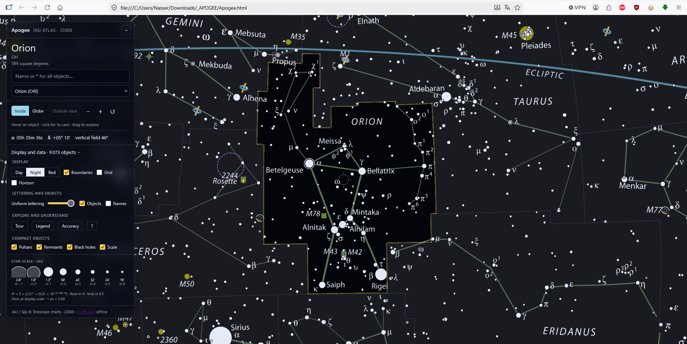

# APOGEE

An interactive atlas of IAU constellations and objects in the sky. The app is
self-contained: open [`index.html`](index.html) in a modern browser, even when
offline. Its required catalogues are embedded in the HTML file.

APOGEE includes original pulsar and black-hole symbols, `*` wildcard search,
and thin-space grouping for large numbers.

## License

**Original APOGEE application code and original symbols** are released under
[0BSD](LICENSE). They may be used, modified, and redistributed for any purpose,
including commercial use, without a notice-retention requirement.

The HTML also contains third-party works under **their own terms**: adapted
IAU/Sky & Telescope charts (CC BY 4.0), adapted HYG and OpenNGC catalogue data
(CC BY-SA 4.0), and bundled Three.js (MIT). Other scientific catalogues are
credited, but no unrestricted reuse license has been established for them.
See [third-party notices](THIRD_PARTY_NOTICES.md) and the app's Legend dialog.
The 0BSD grant does not apply to the entire HTML file as a single work.

## Included files

The 89 source PDFs in the local `UAI/` folder are not needed to run the app and
are not included. The adapted chart data are already embedded in `index.html`.
